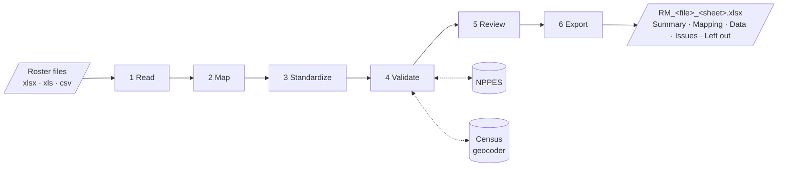

# Roster Mapper

Provider rosters come in every shape. Roster Mapper turns any roster file (xlsx, xls or csv) into a clean change file for your provider directory, with a summary of the mapping, every issue, and every row left out and why.



1. **[Read](docs/steps.md#1-read)**: every sheet into rows; SSNs removed as the file is read
2. **[Map](docs/steps.md#2-map)**: find the header row, match columns to [schema fields](docs/canonical_fields.md), detect the action and category
3. **[Standardize](docs/steps.md#3-standardize)**: dates, NPIs, TINs, ZIPs, phones, states and names into one format; rows that can't move forward are left out
4. **[Validate](docs/steps.md#4-validate)**: NPIs against NPPES, addresses against the US Census geocoder
5. **[Review](docs/steps.md#5-review)**: providers, practice locations and billing entities, and how they connect
6. **[Export](docs/steps.md#6-export)**: one workbook per sheet, plus `summary.xlsx` for a batch

The command line and the UI run the same pipeline. Both can go one step at a time to debug a roster: `--steps`, or **Step by step** in the UI.

## Use it

```bash
npm install -g rostermapper
```

```bash
rostermapper roster.xlsx
```

That writes `output/RM_roster_<sheet>.xlsx`. Pass a folder to map every roster in it, `--steps` to see each step's result, or `--ui` to open the UI. As a library: `npm install rostermapper`. See **[Usage](docs/usage.md)** for the command line, the UI, the library and embedding.

## Docs

- [Usage](docs/usage.md): command line, UI, library (`rostermapper`, `rostermapper/workbook`, `rostermapper/node`), embedding the UI
- [Processing steps](docs/steps.md): what each step does, which rows are left out and why, the output files
- [Canonical fields](docs/canonical_fields.md): the schema every roster is mapped to
- [Contributing](CONTRIBUTING.md): development setup, project layout, schema changes

## License

MIT. Uses NPPES and the US Census geocoder (public domain) and embeds the NUCC taxonomy under its own notice; see [NOTICE](NOTICE).
